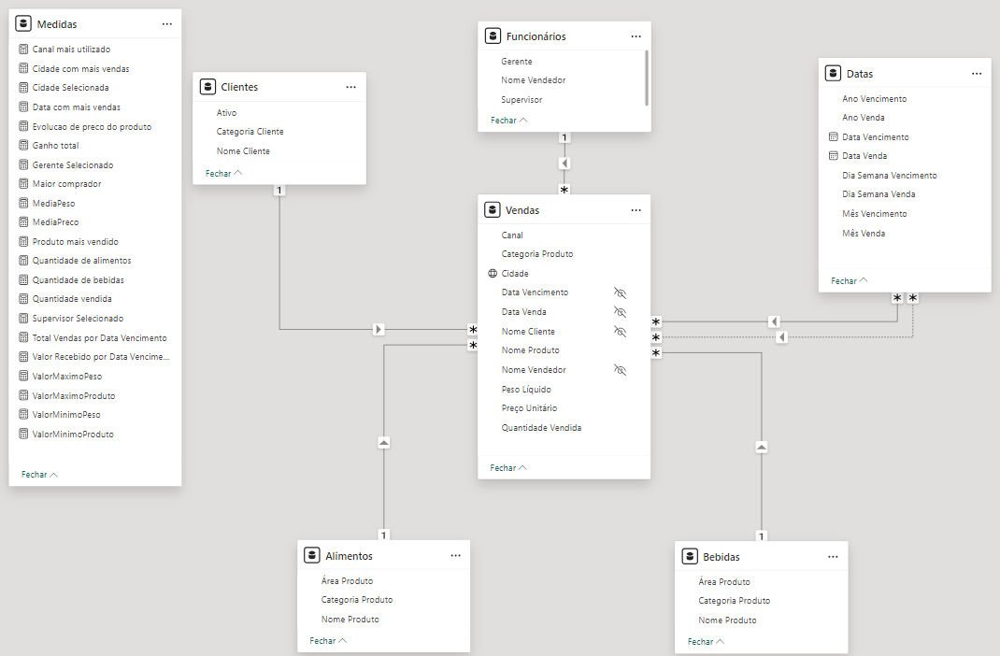
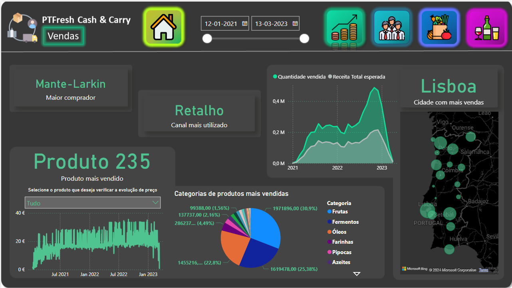
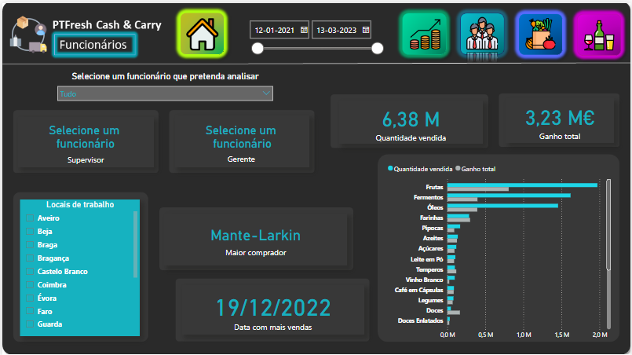
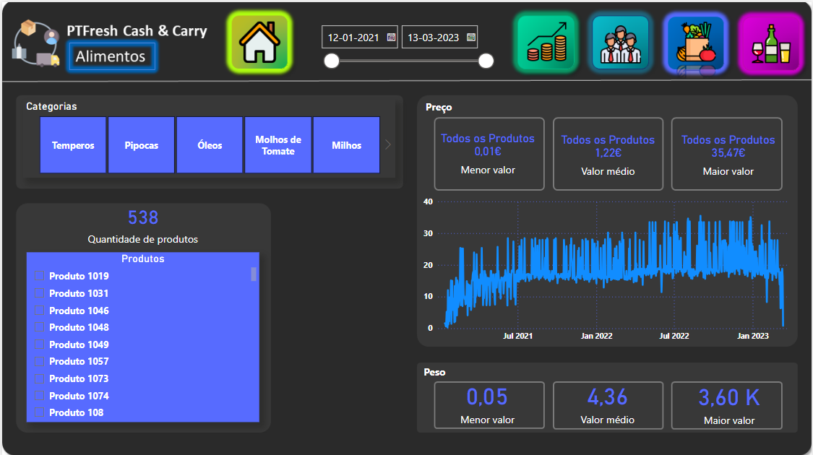
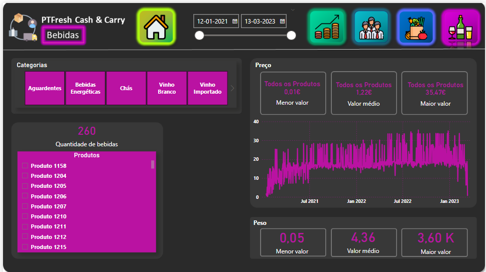

# Retail Sales BI Dashboard

A Power BI dashboard analyzing two years of e-commerce sales data for a wholesale retailer, covering sales performance, employee results, and product pricing across food and beverage categories. Built for the Data Science course of my BSc in Computer Engineering at UTAD.

## 📊 The dataset

16 columns of raw transaction data between January 2021 and March 2023, sale and due dates, customer and city, product, category and area (food or beverage), salesperson, supervisor and manager, distribution channel, quantity, unit price and net weight. Four questions guided the analysis: which cities and products perform best, how employees and their teams are doing, and how pricing and weight behave within the food and beverage catalogs.

## 🗄️ Data model

<p align="center">
  
</p>

The flat source table was split into seven: `Vendas` (the fact table), `Datas`, `Clientes`, `Funcionários`, and separate `Alimentos`/`Bebidas` dimension tables so the food and beverage pages could each work with just their own products.

A couple of details that took real DAX work to get right:

- **Two relationships to the same date table.** `Vendas` links to `Datas` through both the sale date and the due date, but only one relationship can be active at a time. Measures that need the inactive one activate it on demand with `USERELATIONSHIP`:
  ```
  Valor Recebido por Data Vencimento =
  CALCULATE(
      SUMX(Vendas, Vendas[Quantidade Vendida] * Vendas[Preço Unitário]),
      USERELATIONSHIP(Datas[Data Vencimento], Vendas[Data Vencimento])
  )
  ```
- **Drill-down without a direct relationship.** The Employees page shows a salesperson's supervisor and manager on selection, looked up from the `Funcionários` table rather than modeled as a relationship:
  ```
  Supervisor Selecionado =
  IF(
      HASONEVALUE('Funcionários'[Nome Vendedor]),
      LOOKUPVALUE('Funcionários'[Supervisor], 'Funcionários'[Nome Vendedor], SELECTEDVALUE('Funcionários'[Nome Vendedor])),
      "Selecione um funcionário"
  )
  ```

## 📈 Dashboard pages

**Sales**, volume by city on a map, the best-selling product with its price trend, top categories by revenue, and expected revenue vs. units sold over time.

<p align="center">
  
</p>

**Employees**, pick a salesperson to see their supervisor, manager, working cities, total units sold, total profit, and their best-selling categories.

<p align="center">
  
</p>

**Food** and **Beverages**, same layout applied to each product area separately, category browser, min/average/max price and weight, and a price-over-time chart per product.

<p align="center">
  
  
</p>

## 🛠️ Tech Stack

<p align="center">
  
  
  
  
  
</p>

## 📂 Repository structure

```
Projeto Final.pbix                     Power BI report (data model + 4 dashboard pages)
PTFresh Cash and Carry.xlsx            source dataset
assets/
  data-model.png
  dashboard-sales.png
  dashboard-employees.png
  dashboard-food.png
  dashboard-beverages.png
```

## 👤 About

Part of my portfolio. See my [GitHub profile](https://github.com/linho22w) for more projects in AI/ML and backend development.
